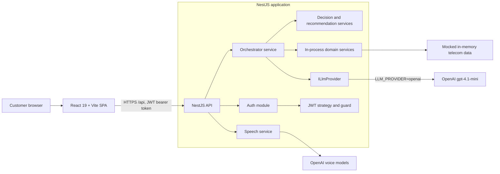
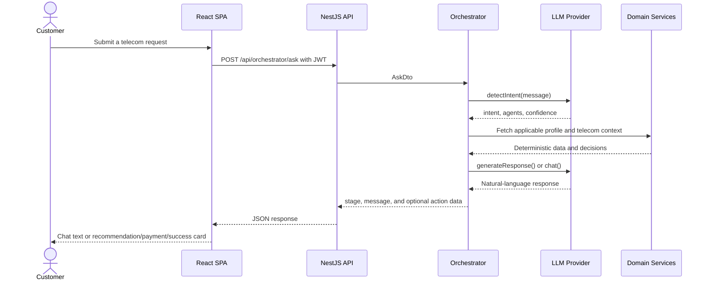

# CAPG Telecom AI Architecture

## Purpose

CAPG Telecom AI is a full-stack telecom self-care application. Customers use a
React web application to view account information and converse with Telly, an
AI telecom assistant. The NestJS API owns authentication, orchestration, and
the domain services that supply recommendations, billing, recharge, payment,
roaming, eSIM, and support capabilities.

The application is a reference implementation: customer, catalog, payment, and
billing data are in memory. Domain decisions remain deterministic in backend
services; OpenAI is used only for language and optional voice interactions.

## Runtime Topology

## Frontend

The Vite-built React single-page application provides the chat experience and
protected self-care dashboards for profile, analytics, plans, billing,
roaming, eSIM, and support. `useAuth()` stores the JWT in browser local
storage. `useApi<T>()` sends authenticated requests, and `useChat()` drives the
orchestrated conversation. The production frontend is served by Nginx, which
proxies `/api/*` to the backend Compose service.

## Backend Responsibilities

| Component | Responsibility |
| --- | --- |
| Auth | Validates mock credentials, issues one-hour JWTs, and protects API routes. |
| Controllers | Expose REST endpoints and validate request DTOs. |
| Orchestrator | Detects intent, gathers domain context, selects workflows, and returns presentation-ready response stages. |
| Recommendation and decision services | Deterministically rank plans and apply customer intelligence and custom-bundle rules. |
| Domain services | Provide profile, usage, plan, billing, recharge, payment, roaming, eSIM, support, analytics, and autopilot operations. |
| LLM provider | Abstracts mock and OpenAI implementations behind `ILlmProvider`. |
| Speech service | Provides optional transcription, synthesis, and Realtime voice sessions when an OpenAI key is present. |
| Common | Applies API response wrapping, correlation-aware logging, and exception handling. |

Domain services are injected directly into the orchestrator. They do not make
HTTP calls to one another, so the multi-agent structure is a code-level
orchestration boundary rather than a distributed microservice topology.

## Conversational Flow

For the recharge journey, the frontend sends `confirm` after a plan selection
and `payment_success` after payment. The orchestrator then confirms payment,
applies recharge, records billing activity, and produces the completion
response. Conversation history is held per customer in process and is lost
when the backend restarts.

## LLM and Voice Model Configuration

All model selection is environment-driven. `LLM_PROVIDER=mock` avoids OpenAI
calls and is the safe local default when no API key is configured.

| Environment variable | Default model | Used for |
| --- | --- | --- |
| `OPENAI_MODEL` | `gpt-4.1-mini` | Intent classification, response rewriting, and Telly chat |
| `OPENAI_TRANSCRIPTION_MODEL` | `gpt-4o-mini-transcribe` | Speech-to-text |
| `OPENAI_TTS_MODEL` | `gpt-4o-mini-tts` | Text-to-speech |
| `OPENAI_REALTIME_MODEL` | `gpt-realtime-mini` | Browser realtime text and audio sessions |

`OPENAI_API_KEY` is required for the OpenAI provider and every voice endpoint.
The Docker Compose file forwards all four model settings to the backend. Copy
`.env.example` to `.env` and select models appropriate for latency, quality,
availability, and cost requirements.

## Deployment

Docker Compose starts two containers on the private `telecom-net` network:

| Service | Internal role | Host port |
| --- | --- | --- |
| `backend` | NestJS API | `3001` |
| `frontend` | Nginx-served React application | `4173` |

The API exposes Swagger documentation at `http://localhost:3001/api/docs`.

## Security and Operational Boundaries

- JWT guards protect non-auth API endpoints; the frontend attaches the token to API calls.
- OpenAI credentials remain server-side. Browser voice flows obtain a backend-created Realtime session instead of an API key.
- Secrets must be provided through environment variables and never committed.
- Global exception filtering and correlation-ID logging support request tracing.
- The application has no persistence layer, payment gateway, or production-grade identity store. Restarting the backend resets all in-memory state.

## Key Source Locations

- `backend/src/orchestrator/orchestrator.service.ts`: request orchestration and conversational state.
- `backend/src/llm/`: provider interface, mock fallback, OpenAI provider, and Telly prompt configuration.
- `backend/src/speech/speech.service.ts`: OpenAI voice integrations.
- `backend/src/agents/`: domain-service modules.
- `frontend/src/pages/ChatPage.tsx`: chat and voice interface.
- `docker-compose.yml`: deployment topology and environment forwarding.