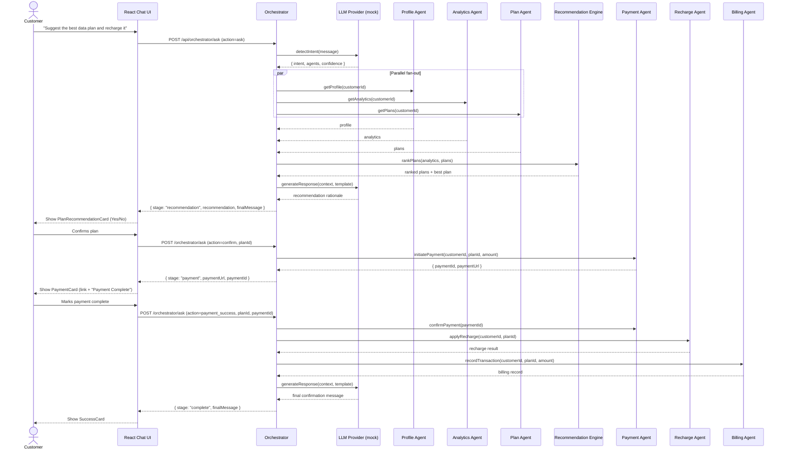

`# Telecom AI Self-Care Platform

An original, full-stack reference implementation of an AI-driven telecom
self-care experience. A customer chats with an AI assistant that orchestrates
a set of specialized backend "agents" (profile, analytics, plans, billing,
recharge, payment, roaming, eSIM, and support) to answer questions, recommend
the best data plan for a customer's usage, and walk them through a recharge
and payment flow end-to-end.

> All telecom, payment, and billing data is mocked and held in memory. There
> is no real database or payment gateway. The LLM layer defaults to a
> deterministic mock provider locally and can use OpenAI when configured.
> Telly Autopilot is also simulated: it can update mock bill and recharge
> settings, but it does not authorize or charge real money. There is no
> background payment scheduler; a mock pending bill is marked paid only when
> the customer asks Telly to process it, and Autopilot settings reset on
> backend restart.

## Architecture

```
/backend   NestJS (TypeScript) API — multi-agent orchestration
/frontend  React 19 (TypeScript + Vite) — chat UI + self-care dashboards
```

### Backend (NestJS)

- **Auth module** — mock username/password login, issues JWTs (1h expiry),
  `JwtAuthGuard` protects every other endpoint.
- **LLM module** — `ILlmProvider` interface with a `MockLlmProvider`
  (keyword-based intent detection + template-based response generation) and
  an `OpenAiLlmProvider` behind a provider factory
  (`LLM_PROVIDER=mock|openai`). Chat defaults to `gpt-4.1-mini` when OpenAI
  is selected.
- **Speech module** — optional OpenAI speech-to-text, text-to-speech, and
  browser Realtime session endpoints. Defaults are `gpt-4o-transcribe`,
  `gpt-4o-mini-tts`, and `gpt-realtime-mini` respectively.
- **Agent modules** — one NestJS module per domain: `profile`, `analytics`,
  `plan`, `billing`, `recharge`, `payment`, `roaming`, `support`, `esim`.
  Each exposes a small REST API and an injectable service that can be called
  directly by the orchestrator (no HTTP hop between agents).
- **Orchestrator module** — the heart of the system. `POST /api/orchestrator/ask`
  detects intent, fans out to the Profile/Analytics/Plan agents in parallel,
  asks an internal `RecommendationService` to rank plans against the
  customer's usage, generates a natural-language rationale, and then drives
  a stateful (but request-driven) conversation through payment and recharge.
- **Customer-care journeys** — the assistant can triage common network
  problems with safe self-checks, compare recorded bills without inventing
  line items, preserve travel requirements across turns, and request explicit
  consent before creating a support ticket.
- **Roaming prices** — recommendations convert the INR catalog into the
  recognized destination country's currency, including component prices and
  discounts, using dated exchange rates.
- **Common** — global exception filter, correlation-ID logging interceptor,
  and a generic `ApiResponseDto<T>` wrapper.

### Frontend (React + Vite)

- Plain CSS Modules, dark sidebar / light content, blue-teal (`#0ea5e9`) accent.
- `/chat` — the main assistant experience. Renders different rich cards
  based on the orchestrator response's `stage`:
  `recommendation` → `PlanRecommendationCard`, `payment` → `PaymentCard`,
  `complete` → `SuccessCard`.
- `/profile`, `/analytics`, `/plans`, `/billing`, `/roaming`, `/esim`,
  `/support` — dashboards that fetch live data from the backend (no
  hardcoded mock data on the frontend), with loading/error/empty states.
- `useAuth()` (JWT stored in `localStorage`) and a generic `useApi<T>()` data
  hook power all pages.

## Provider value and demo scenarios

This prototype is intended to demonstrate an AI service layer that can resolve
routine customer-care work, guide customers to suitable offers, and hand off
cases with useful context instead of making them repeat the problem. A
provider such as Airtel or Jio could evaluate it as a digital-care,
agent-assist, and responsible offer-discovery layer—not as a replacement for
the provider's billing, network, CRM, or provisioning systems.

| Customer query | Agent behavior in this prototype | Safe boundary |
| --- | --- | --- |
| “How much data do I have left?” | Uses the customer's analytics record and suggests a relevant next step. | Reports the demo account data only. |
| “My bill is higher than expected.” | Compares the two latest recorded bills and offers an investigation ticket. | Does not invent charge breakdowns; asks before creating the ticket. |
| “My mobile data is slow in Pune.” | Gives low-risk reconnect checks, captures an approximate area, then offers a network support handoff if the issue persists. | No live Airtel/Jio outage or radio telemetry is connected, so it never claims an outage was checked. |
| “I lost my phone.” | Guides the customer through SIM security and replacement support. | Sensitive account actions require the existing confirmation flow. |
| “I need an eSIM.” | Checks eSIM status and guides activation in the demo. | Device compatibility, eSIM inventory, and carrier provisioning need provider integrations. |
| “I’m travelling; I need 500GB and an eSIM.” | Carries constraints across turns and checks the roaming catalog before recommending. | Does not label a smaller pack as a match; asks before opening a quote request. |
| “Find a plan that costs less.” | Uses profile and usage context to tailor a plan recommendation. | Activation and payment remain explicit customer actions. |
| “My recharge was deducted but service did not update.” | Warns against retrying blindly and offers a payment/provisioning investigation ticket. | Does not claim payment or activation succeeded; asks before creating the ticket. |
| “I want to cancel or port my number out.” | Acknowledges the request and offers a human service-change handoff. | Does not obstruct, apply a retention offer automatically, or claim a cancellation/port-out was completed. |

### Why a provider might buy

- **Lower avoidable care cost:** resolve routine usage, bill-history, plan,
  roaming, and basic connectivity questions in digital channels.
- **Better agent productivity:** pass a consented, structured case summary
  (symptom, location, checks tried, or bill comparison) into human support.
- **More relevant conversion:** recommend only catalog-backed upgrades or
  add-ons that fit the customer's stated needs, with no silent activation.
- **Retention and customer experience:** recognize repeated problems, provide
  a clear next action, and avoid restarting qualification on every turn.
- **Measurable rollout:** start with a narrow set of intents, compare against
  a control group, and expand only when quality and economics improve.

### Pilot economics and success measures

Do not assume a generic “AI saves X%” claim. Establish each provider's baseline
and calculate monthly value using its own costs and conversion margins:

```text
monthly benefit =
  deflected eligible contacts × avoidable cost per contact
  + agent-assisted contacts × minutes saved × cost per agent minute
  + incremental conversions × contribution margin
  + retained customers × expected contribution margin

monthly net value = monthly benefit - platform, integration, inference,
                    and governance costs
```

Track containment and first-contact resolution alongside repeat contact rate,
CSAT, human-transfer rate, average handling time, plan conversion, cost per
resolution, and factual-error/unauthorized-action rate. Treat customer consent,
safe escalation, and factual accuracy as launch gates—not trade-offs against
conversion.

### What is needed before production

The included data and workflows are in-memory demo fixtures. A provider pilot
needs authenticated APIs for customer identity and consent, current offers and
eligibility, bill line items, payment and recharge status, eSIM inventory and
device compatibility, network incidents/coverage, CRM case creation, audit
events, retention policy, and provider-specific security controls. Until an
integration exists, the assistant must state that it cannot verify that data;
the prototype intentionally avoids presenting mock capability as a live
provider action.

## Orchestration sequence



## Telly telecom agent configuration

The backend now includes a production-focused telecom voice-agent prompt for Telly. The configuration lives in [backend/src/llm/telecom-agent-config.ts](backend/src/llm/telecom-agent-config.ts) and defines:

- empathy-first customer care behavior (emotion acknowledgement before troubleshooting)
- real-time conversational behavior for voice interactions (full-duplex style, interruption-aware, context continuity)
- proactive intent mapping for common telecom support situations (lost phone, travel, billing concerns, weak network, recharge)
- concise and human-like support responses with next-best-action guidance
- a telecom service catalog used for grounded recommendations and plan/add-on suggestions

### How to configure it

1. Set the backend LLM provider:
   - `LLM_PROVIDER=mock` for local development with the built-in prompt logic
   - `LLM_PROVIDER=openai` with `OPENAI_API_KEY=<your-key>` to use the OpenAI-backed provider
2. Expand the catalog in [backend/src/llm/telecom-agent-config.ts](backend/src/llm/telecom-agent-config.ts) with real product names, prices, and service tags.
3. Keep the prompt aligned with your business goals:
  - preserve empathy-first phrasing and interruption-aware voice behavior
  - recommend bundles that combine base plans with relevant add-ons
  - proactively suggest next-best actions for likely customer needs
  - keep responses concise to reduce voice latency in real-time sessions

### Recommended product data to include

For a more robust deployment, add entries for:

- base plans with data, voice, and price
- unlimited voice packs
- roaming packs by destination or region
- OTT bundles such as Netflix, Disney+, Prime Video
- premium support, hotspot, gaming, and family-sharing features
- business and enterprise bundles

This setup is designed to make Telly feel like a tailored telecom advisor that can engage customers, understand their needs, and present custom offers that go beyond standard prebuilt packages.

## Voice QA checklist

Use this checklist to validate production-ready voice-to-voice behavior.

### 1. Setup and baseline

1. Start services:

```bash
docker compose up --build
```

2. Open the UI at `http://localhost:4173`.
3. Sign in with demo credentials (`user1` / `password123`).
4. Open browser console and verify no speech-related runtime errors.

Pass criteria:
- Login succeeds.
- Mic button is visible and usable.
- No `SpeechRecognition` or `speechSynthesis` errors in console.

### 2. Interruption handling (full-duplex behavior)

Test flow:
1. Start a voice prompt that triggers a longer assistant response.
2. While the assistant is speaking, interrupt with a new voice utterance.
3. Verify the assistant stops speaking immediately.
4. Verify the next response addresses the interruption context.

Suggested prompts:
- "I am travelling to USA and need roaming plus India calls."
- Interrupt with: "Actually priority is low cost calling India."

Pass criteria:
- Ongoing speech is cut off on interruption.
- Assistant does not restart the old sentence.
- Assistant continues from updated user intent.
- A brief hesitation or pause does not trigger a premature reply.
- A completed user turn produces one assistant response and one audible voice.
- The assistant's concise reply appears in chat without a "Voice summary" label.
- Billing responses show viewable bill details and can open a prefilled email draft.
- "Last two months" returns two bill records with date, amount, and paid status; selecting one expands its details.
- Netherlands roaming prices use the EUR equivalent from the latest ECB reference rate, consistently in speech and chat.
- A plan is reported as activated only after payment succeeds; otherwise the status remains not activated.
- Recommendation responses show activate and decline actions when a plan is available.

### 3. Sentiment and empathy quality
Test scenarios:
1. Distress: "I lost my phone and I am panicking."
2. Frustration: "My bill is too high, this is ridiculous."
3. Confusion: "I don't understand which plan is right for me."
4. Say a full answer with natural pauses between phrases and verify the agent waits, understands the whole answer, and responds to its emotional cues without guessing.

Pass criteria:
- Assistant acknowledges emotion first.
- Assistant reassures before troubleshooting.
- Assistant provides actionable next steps in telecom scope.

### 4. Proactive next-best actions

Test scenarios:
1. Partial intent: "I am travelling next week."
2. Budget intent: "Need cheaper options."
3. Usage intent: "I need more call time, not data."

Pass criteria:
- Assistant predicts likely needs without repeated probing.
- Assistant offers relevant options (roaming/calling/plan optimization).
- Response stays concise and conversational.

### 5. Context continuity across turns

Test flow:
1. Ask for roaming help.
2. Follow up with: "What was the second option again?"
3. Switch to another related ask: "Will this keep my India number active?"

Pass criteria:
- Assistant remembers prior options.
- No reset to generic greeting.
- Follow-ups are answered without redundant re-collection.

### 6. Latency targets

Measure approximately from end-of-user-utterance to start-of-assistant-speech.

Recommended targets:
- Good: <= 1.5s
- Acceptable: <= 2.5s
- Investigate: > 2.5s

Pass criteria:
- Most turns stay in Good/Acceptable range.
- No repeated long pauses under stable network conditions.

### 7. API sanity checks (backend)

Use quick API checks to ensure orchestration is healthy.

```bash
TOKEN=$(curl -sS -X POST http://localhost:3001/api/auth/login \
  -H 'Content-Type: application/json' \
  -d '{"username":"user1","password":"password123"}' | \
  sed -n 's/.*"accessToken":"\([^"]*\)".*/\1/p')

curl -sS -X POST http://localhost:3001/api/orchestrator/ask \
  -H "Authorization: Bearer $TOKEN" \
  -H 'Content-Type: application/json' \
  -d '{"message":"show all available plans","customerId":"cust-001","action":"ask"}'
```

Pass criteria:
- Login returns a token.
- Ask endpoint returns valid JSON with `intent`, `agents`, `stage`, and `finalMessage`.

### 8. Regression checks

1. Typed messages remain text-only (no forced speech output).
2. Voice-originated messages can produce spoken reply.
3. Chat history remains when navigating left menu pages.

Pass criteria:
- No regression in text-only flow.
- Voice path works independently.
- Conversation persists across route transitions.

## Getting started (local, without Docker)

### Backend

```bash
cd backend
npm install
npm run start:dev
```

The API listens on `http://localhost:3001/api`.

### Frontend

```bash
cd frontend
npm install
npm run dev
```

The UI is served at `http://localhost:5173` and talks to the backend at the
URL configured in `frontend/.env` (`VITE_API_URL`).

### Demo login

```
username: user1
password: password123
```

## Getting started (Docker)

```bash
docker compose up --build
```

- Frontend: http://localhost:4173
- Backend API: http://localhost:3001/api
- Swagger docs: http://localhost:3001/api/docs

The frontend's Nginx container proxies `/api/*` requests to the `backend`
service inside the Compose network.

## API documentation

Interactive Swagger UI is available at **`/api/docs`** once the backend is
running (e.g. `http://localhost:3001/api/docs`). It documents every REST
endpoint, including request/response DTOs and JWT bearer auth.

## Running tests

### Backend unit tests

```bash
cd backend
npm test
```

Covers intent detection & fan-out orchestration, profile/analytics/plan
agent shapes, and the plan-ranking logic in the recommendation engine.

### Backend e2e test

```bash
cd backend
npm run test:e2e
```

### Backend build

```bash
cd backend
npm run build
```

### Frontend build

```bash
cd frontend
npm run build
```

## Environment variables

### Backend (`backend/.env`)

| Variable                     | Default                       | Description                                      |
| ---------------------------- | ----------------------------- | ------------------------------------------------ |
| `PORT`                       | `3001`                        | HTTP port the NestJS server listens on           |
| `JWT_SECRET`                 | `please-set-a-secure-jwt-secret` | Secret used to sign/verify JWTs               |
| `LLM_PROVIDER`               | `mock`                        | `mock` or `openai` (provider selection)          |
| `OPENAI_MODEL`               | `gpt-4.1-mini`                | Conversation and intent model                     |
| `OPENAI_TRANSCRIPTION_MODEL` | `gpt-4o-transcribe`           | Speech-to-text model                              |
| `OPENAI_TTS_MODEL`           | `gpt-4o-mini-tts`             | Text-to-speech model                              |
| `OPENAI_REALTIME_MODEL`      | `gpt-realtime-mini`           | Realtime browser voice model                      |
| `NODE_ENV`                   | `development`                 | Standard Node environment flag                    |

### Frontend (`frontend/.env`)

| Variable       | Default                          | Description                     |
| -------------- | --------------------------------- | -------------------------------- |
| `VITE_API_URL` | `http://localhost:3001/api`       | Base URL the SPA calls the API on |

## Project layout

```
backend/
  src/
    orchestrator/      # AskDto, OrchestratorService, RecommendationService
    agents/
      profile/  billing/  recharge/  plan/  roaming/  payment/  support/  analytics/  esim/
    auth/               # login, JWT strategy/guard
    llm/                # ILlmProvider, MockLlmProvider, OpenAiLlmProvider
    common/             # exception filter, logging interceptor, DTOs
  test/                 # e2e test
frontend/
  src/
    components/         # layout, chat, common (charts, spinners, errors)
    pages/              # Chat, Profile, Analytics, Plans, Billing, Roaming, eSIM, Support, Login
    hooks/              # useAuth, useApi
    services/           # api.ts (axios), types.ts
    routes/             # ProtectedRoute
docker-compose.yml
```
