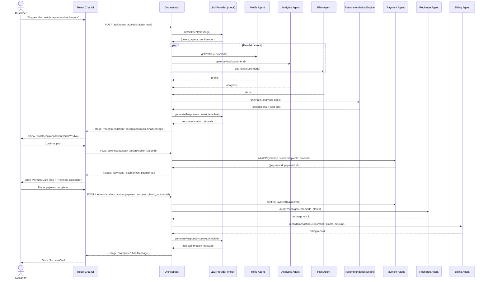

`# Telecom AI Self-Care Platform

An original, full-stack reference implementation of an AI-driven telecom
self-care experience. A customer chats with an AI assistant that orchestrates
a set of specialized backend "agents" (profile, analytics, plans, billing,
recharge, payment, roaming, eSIM, and support) to answer questions, recommend
the best data plan for a customer's usage, and walk them through a recharge
and payment flow end-to-end.

> All data in this project is mocked and held in memory. There is no real
> database, no real payment gateway, and no real LLM call — the "LLM" layer
> is a deterministic mock provider that can later be swapped for a real
> provider (e.g. OpenAI) without changing any calling code.

## Architecture

```
/backend   NestJS (TypeScript) API — multi-agent orchestration
/frontend  React 19 (TypeScript + Vite) — chat UI + self-care dashboards
```

### Backend (NestJS)

- **Auth module** — mock username/password login, issues JWTs (1h expiry),
  `JwtAuthGuard` protects every other endpoint.
- **LLM module** — `ILlmProvider` interface with a `MockLlmProvider`
  (keyword-based intent detection + template-based response generation) and
  a stubbed `OpenAiLlmProvider` behind a provider factory
  (`LLM_PROVIDER=mock|openai`).
- **Agent modules** — one NestJS module per domain: `profile`, `analytics`,
  `plan`, `billing`, `recharge`, `payment`, `roaming`, `support`, `esim`.
  Each exposes a small REST API and an injectable service that can be called
  directly by the orchestrator (no HTTP hop between agents).
- **Orchestrator module** — the heart of the system. `POST /api/orchestrator/ask`
  detects intent, fans out to the Profile/Analytics/Plan agents in parallel,
  asks an internal `RecommendationService` to rank plans against the
  customer's usage, generates a natural-language rationale, and then drives
  a stateful (but request-driven) conversation through payment and recharge.
- **Common** — global exception filter, correlation-ID logging interceptor,
  and a generic `ApiResponseDto<T>` wrapper.

### Frontend (React + Vite)

- Plain CSS Modules, dark sidebar / light content, blue-teal (`#0ea5e9`) accent.
- `/chat` — the main assistant experience. Renders different rich cards
  based on the orchestrator response's `stage`:
  `recommendation` → `PlanRecommendationCard`, `payment` → `PaymentCard`,
  `complete` → `SuccessCard`.
- `/profile`, `/analytics`, `/plans`, `/billing`, `/roaming`, `/esim`,
  `/support` — dashboards that fetch live data from the backend (no
  hardcoded mock data on the frontend), with loading/error/empty states.
- `useAuth()` (JWT stored in `localStorage`) and a generic `useApi<T>()` data
  hook power all pages.

## Orchestration sequence



## Telly telecom agent configuration

The backend now includes a richer telecom-agent prompt for Telly so it can act as a sales-oriented assistant rather than a simple keyword router. The configuration lives in [backend/src/llm/telecom-agent-config.ts](backend/src/llm/telecom-agent-config.ts) and defines:

- a persona prompt for Telly with sales, personalization, and upsell behavior
- a service catalog covering plan tiers, add-ons, and benefits such as unlimited calls, roaming, OTT bundles, hotspot, and premium support
- guidance for building hyper-personalized bundles based on customer needs, travel, entertainment, and budget

### How to configure it

1. Set the backend LLM provider:
   - `LLM_PROVIDER=mock` for local development with the built-in prompt logic
   - `LLM_PROVIDER=openai` with `OPENAI_API_KEY=<your-key>` to use the OpenAI-backed provider
2. Expand the catalog in [backend/src/llm/telecom-agent-config.ts](backend/src/llm/telecom-agent-config.ts) with real product names, prices, and service tags.
3. Keep the prompt aligned with your business goals:
   - prioritize discovery questions
   - recommend bundles that combine base plans with add-ons
   - highlight conversion-oriented offers such as unlimited voice, roaming, OTT, and support upgrades

### Recommended product data to include

For a more robust deployment, add entries for:

- base plans with data, voice, and price
- unlimited voice packs
- roaming packs by destination or region
- OTT bundles such as Netflix, Disney+, Prime Video
- premium support, hotspot, gaming, and family-sharing features
- business and enterprise bundles

This setup is designed to make Telly feel like a tailored telecom advisor that can engage customers, understand their needs, and present custom offers that go beyond standard prebuilt packages.

## Getting started (local, without Docker)

### Backend

```bash
cd backend
npm install
npm run start:dev
```

The API listens on `http://localhost:3001/api`.

### Frontend

```bash
cd frontend
npm install
npm run dev
```

The UI is served at `http://localhost:5173` and talks to the backend at the
URL configured in `frontend/.env` (`VITE_API_URL`).

### Demo login

```
username: user1
password: password123
```

## Getting started (Docker)

```bash
docker compose up --build
```

- Frontend: http://localhost:3000
- Backend API: http://localhost:3001/api
- Swagger docs: http://localhost:3001/api/docs

The frontend's Nginx container proxies `/api/*` requests to the `backend`
service inside the Compose network.

## API documentation

Interactive Swagger UI is available at **`/api/docs`** once the backend is
running (e.g. `http://localhost:3001/api/docs`). It documents every REST
endpoint, including request/response DTOs and JWT bearer auth.

## Running tests

### Backend unit tests

```bash
cd backend
npm test
```

Covers intent detection & fan-out orchestration, profile/analytics/plan
agent shapes, and the plan-ranking logic in the recommendation engine.

### Backend e2e test

```bash
cd backend
npm run test:e2e
```

### Backend build

```bash
cd backend
npm run build
```

### Frontend build

```bash
cd frontend
npm run build
```

## Environment variables

### Backend (`backend/.env`)

| Variable       | Default                             | Description                                   |
| -------------- | ----------------------------------- | ---------------------------------------------- |
| `PORT`         | `3001`                              | HTTP port the NestJS server listens on         |
| `JWT_SECRET`   | `please-set-a-secure-jwt-secret`    | Secret used to sign/verify JWTs                |
| `LLM_PROVIDER` | `mock`                              | `mock` or `openai` (provider selection)        |
| `NODE_ENV`     | `development`                       | Standard Node environment flag                 |

### Frontend (`frontend/.env`)

| Variable       | Default                          | Description                     |
| -------------- | --------------------------------- | -------------------------------- |
| `VITE_API_URL` | `http://localhost:3001/api`       | Base URL the SPA calls the API on |

## Project layout

```
backend/
  src/
    orchestrator/      # AskDto, OrchestratorService, RecommendationService
    agents/
      profile/  billing/  recharge/  plan/  roaming/  payment/  support/  analytics/  esim/
    auth/               # login, JWT strategy/guard
    llm/                # ILlmProvider, MockLlmProvider, OpenAiLlmProvider
    common/             # exception filter, logging interceptor, DTOs
  test/                 # e2e test
frontend/
  src/
    components/         # layout, chat, common (charts, spinners, errors)
    pages/              # Chat, Profile, Analytics, Plans, Billing, Roaming, eSIM, Support, Login
    hooks/              # useAuth, useApi
    services/           # api.ts (axios), types.ts
    routes/             # ProtectedRoute
docker-compose.yml
```
